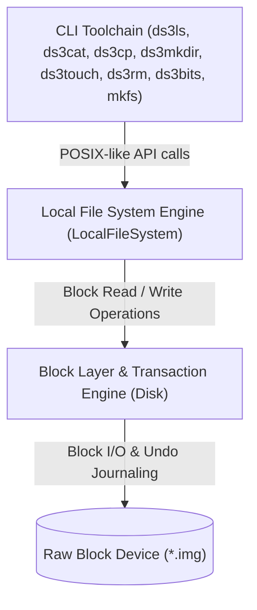

# Persistent Unix-Style File System (`ds3`)

A high-performance, crash-resilient Unix-style file system (VSFS / UFS) implemented from scratch in C++. The system manages hierarchical directory trees, bitwise resource allocation, inode metadata mapping, and block-level data storage on top of a simulated raw block device with transactional journaling for crash consistency.

---

## Technical Highlights

- **Crash Resilience & Atomicity**: Transaction-based undo logging system providing atomic multi-block operations (`beginTransaction()`, `commit()`, `rollback()`) to protect against incomplete disk writes and metadata corruption.
- **On-Disk Persistence**: Custom on-disk layout featuring superblocks, allocation bitmaps, inode tables, and linear directory entry pools mapped directly to 4096-byte blocks.
- **POSIX-Like File Operations**: Complete programmatic interface supporting recursive path lookup, file creation, truncation, partial-write semantics on disk exhaustion, and entry compaction upon deletion.
- **Bitwise Space Allocation**: Fast LSB-first bit manipulation algorithms for continuous inode and data block tracking.
- **Administrative Toolchain**: Comprehensive suite of Unix CLI utilities for disk formatting, block-level bitmap inspection, directory traversal, file transfers, and metadata auditing.

---

## Architecture & System Overview

The file system bridges low-level physical block storage with hierarchical, POSIX-style file abstractions:



### Abstraction Layers

1. **Physical Block & Transaction Layer (`Disk`)**:
   - Manages raw I/O across fixed-size blocks (4096 bytes per block).
   - Implements an in-memory undo log transaction system that captures pre-images of modified blocks. If a multi-block operation encounters an out-of-storage error or fault, changes roll back cleanly to maintain disk consistency.

2. **File System Layer (`LocalFileSystem`)**:
   - Manages hierarchical directories, path resolution, file metadata, and dynamic block allocation.
   - Implements standard file system primitives: `lookup`, `stat`, `read`, `write`, `create`, and `unlink`.

---

## On-Disk Storage Layout

The on-disk format is structured into five sequential, contiguous regions:

```
+------------+------------------+-----------------+------------------+------------------+
| Block 0    | Blocks 1..k      | Blocks k+1..m   | Blocks m+1..n    | Blocks n+1..end  |
| Superblock | Inode Bitmap     | Data Bitmap     | Inode Table      | Data Blocks      |
| (1 block)  | (inode_bmap_len) | (data_bmap_len) | (inode_reg_len)  | (data_reg_len)   |
+------------+------------------+-----------------+------------------+------------------+
```

### 1. Superblock (`super_t`)
Stored at physical **Block 0** (40 bytes), recording the geometry and boundary offsets of all disk regions:
- `inode_bitmap_addr` / `inode_bitmap_len`: Block offset and span of the inode allocation bitmap.
- `data_bitmap_addr` / `data_bitmap_len`: Block offset and span of the data block allocation bitmap.
- `inode_region_addr` / `inode_region_len`: Starting block and length of the inode table.
- `data_region_addr` / `data_region_len`: Starting block and length of the user data region.

### 2. Allocation Bitmaps
- **Bitwise Organization**: Managed LSB-first (`bit = (byte >> bit_index) & 1`). A bit value of `1` indicates an allocated resource; `0` indicates an available resource.
- **Inode Bitmap**: Tracks active inode records in the Inode Table.
- **Data Bitmap**: Tracks active data blocks in the Data Region.

### 3. Inode Table (`inode_t`)
Each inode is 128 bytes, packing exactly 32 inodes per 4096-byte block:
- `type`: File type identifier (`UFS_REGULAR_FILE` = 1 or `UFS_DIRECTORY` = 0).
- `size`: Size of the file or directory payload in bytes.
- `direct[DIRECT_PTRS]`: Array of 30 direct block pointers indexing data blocks in the Data Region.
- **Capacity Specifications**:
  - Direct pointers per inode: `30`
  - Block size: `4096` bytes
  - Maximum file size: $30 \times 4096 = 122,880$ bytes (120 KB)
  - Root directory inode: Fixed at Inode Number `0` (`UFS_ROOT_DIRECTORY_INODE_NUMBER`).

### 4. Directory Structure (`dir_ent_t`)
Directories are stored as regular data blocks containing arrays of 32-byte directory entries:
- `char name[28]`: Null-terminated entry name (up to 27 characters + null terminator).
- `int inum`: Inode number pointing to the referenced file or directory (`-1` indicates an unallocated/deleted slot).
- Every directory is initialized with `.` (referencing itself) and `..` (referencing its parent).

---

## Command-Line Toolchain

The project includes eight command-line utilities for creating, inspecting, reading, and modifying disk images:

### 1. Format Disk (`mkfs`)
Formats a raw disk image, laying out the superblock, allocation bitmaps, empty inode table, and root directory (`/` at inode 0):

```bash
./mkfs -f <disk_image> -d <num_data_blocks> -i <num_inodes>
```
*Example:*
```bash
./mkfs -f disk.img -d 64 -i 32
```

### 2. Inspect Bitmaps (`ds3bits`)
Audits and displays the allocation state of the inode and data block bitmaps:

```bash
./ds3bits <disk_image>
```

### 3. List Directory (`ds3ls`)
Traverses the directory tree to list entries, file types, sizes, and inode numbers:

```bash
./ds3ls <disk_image> [directory_path]
```
*Examples:*
```bash
./ds3ls disk.img /
./ds3ls disk.img /documents/reports
```

### 4. Display File Content (`ds3cat`)
Streams the byte contents of a file given its inode number:

```bash
./ds3cat <disk_image> <inode_number>
```
*Example:*
```bash
./ds3cat disk.img 1
```

### 5. Transfer File to Disk (`ds3cp`)
Copies an external file from the host operating system into a designated inode on the disk image:

```bash
./ds3cp <disk_image> <host_source_path> <dst_inode_number>
```
*Example:*
```bash
./ds3cp disk.img sample.txt 1
```

### 6. Create Directory (`ds3mkdir`)
Allocates a new directory inode and links it under a parent directory:

```bash
./ds3mkdir <disk_image> <parent_inode_number> <dir_name>
```
*Example:*
```bash
./ds3mkdir disk.img 0 documents
```

### 7. Create Empty File (`ds3touch`)
Allocates a new regular file inode and links it under a parent directory:

```bash
./ds3touch <disk_image> <parent_inode_number> <file_name>
```
*Example:*
```bash
./ds3touch disk.img 0 notes.txt
```

### 8. Remove Entry (`ds3rm`)
Unlinks a regular file or empty directory from its parent, reclaiming its allocated data blocks and inode in the bitmaps:

```bash
./ds3rm <disk_image> <parent_inode_number> <entry_name>
```
*Example:*
```bash
./ds3rm disk.img 0 notes.txt
```

---

## File System Core API

The `LocalFileSystem` class provides the programmatic interface to all on-disk operations:

| Method | Description | Return Semantics |
| :--- | :--- | :--- |
| `lookup(int parentInodeNumber, string name)` | Searches a parent directory for an entry matching `name`. | Inode number on success; negative error code on failure. |
| `stat(int inodeNumber, inode_t *inode)` | Loads the inode metadata record into the provided buffer. | `0` on success; negative error code on failure. |
| `read(int inodeNumber, void *buffer, int size)` | Reads up to `size` bytes starting from byte offset 0. | Bytes read on success; negative error code on failure. |
| `write(int inodeNumber, const void *buffer, int size)` | Overwrites file data, dynamically allocating blocks up to `MAX_FILE_SIZE`. | Bytes written on success; negative error code on failure. |
| `create(int parentInodeNumber, int type, string name)` | Allocates an inode and links a new file or directory into the parent. | Inode number on success; negative error code on failure. |
| `unlink(int parentInodeNumber, string name)` | Unlinks an entry, deallocating blocks and compacting directory slots. | `0` on success; negative error code on failure. |
